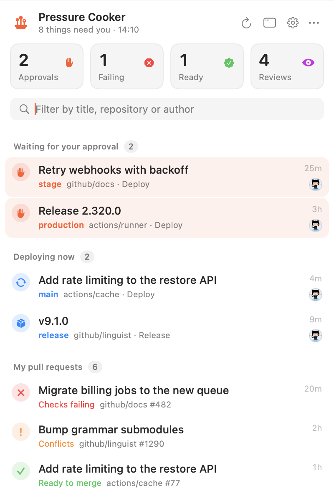

<h1>
  <picture>
    <source media="(prefers-color-scheme: dark)" srcset="assets/icons/icon.svg">
    
  </picture>
  PRessure Cooker
</h1>

Everything on GitHub that is waiting for you, in your menu bar. Pressure Cooker watches the repositories of the accounts and organizations you pick and shows, at a glance:

- **Deployments waiting for your approval** — workflow runs stuck at "Review pending deployments" for an environment you may approve (stage, prod, …).
- **Your open pull requests** — checks failing, conflicts, changes requested, checks running, review required, ready to merge.
- **Review requests** — pull requests where you (or one of your teams) are asked to review.
- Optionally **everyone else's open pull requests** in those repositories.
- **Deploys running right now** — runs on the default branch or for a release, just to see; they don't count as needing you.

<p align="center">
  <picture>
    <source media="(prefers-color-scheme: dark)" srcset="assets/screenshots/list-dark.png">
    
  </picture>
</p>

Native macOS app (SwiftUI + AppKit, macOS 14+). The menu bar icon counts what needs you: waiting deployments, review requests, and your pull requests that are failing or ready to merge. Click it for the list, or open the same list in a window. Clicking an item opens it on GitHub. Notifications for each kind of change can be switched on and off.

Pressure Cooker is open source and free. No accounts, no telemetry, no servers: it talks to the GitHub API with your token and checks GitHub releases once a day for updates.

## Install

Download `PressureCooker-<version>.zip` from [Releases](https://github.com/techtheoryio/pressure-cooker/releases), unzip, and move `PressureCooker.app` to Applications. Builds are signed and notarized. Updates come through [Sparkle](https://sparkle-project.org): Pressure Cooker checks the latest GitHub release once a day and installs new versions on its own.

Or build it yourself (needs Xcode 26 / Swift 6):

```bash
git clone https://github.com/techtheoryio/pressure-cooker.git && cd pressure-cooker
scripts/build-app.sh 0.0.0 && open .build/PressureCooker.app
```

For development:

```bash
swift run PressureCooker   # build and launch (no updates, notifications or login item outside the .app)
swift test                 # status and notification logic
GITHUB_TOKEN=$(gh auth token) GITHUB_OWNERS=my-org swift test   # also checks the queries against the real API
```

`PC_DEMO=1 swift run PressureCooker` shows made-up data in every state instead of GitHub. Add `PC_SNAPSHOT=<dir>` to write PNGs of the list and each settings tab, light and dark, and quit; `-owners '(org1, org2)'` after the command watches accounts for that run without saving them.

## Setup

1. **Token.** If you are signed in with the [gh CLI](https://cli.github.com), there is nothing to do. Otherwise, in Settings → Account, paste a [classic personal access token](https://github.com/settings/tokens/new?scopes=repo,read:org&description=Pressure%20Cooker) with the `repo` and `read:org` scopes; it is kept in your keychain. For organizations with SAML SSO, authorize the token for them. A fine-grained token works too, but covers only one account, and needs read access to *Pull requests* and *Actions*.
2. **Accounts.** In Settings → Repositories, switch on the organizations (or users) whose repositories you care about. All their repositories are watched, including new ones as soon as they appear; switch off single repositories below. Without any watched account you still see your pull requests and review requests from all of GitHub, but no deployments.

Pressure Cooker refreshes every 2 minutes (1–15 in Settings → General). Each refresh is one GraphQL request plus two REST requests per repository pushed to in the last 30 days (a run can't wait for approval longer than that), and one more per repository pushed to in the last day for running deploys, well within GitHub's 5,000 requests an hour.

## Contributing

Bug fixes and polish are always welcome — just open a PR. For a new feature, open an issue first.

- Keep the diff focused. One change per PR.
- No new dependencies (Sparkle for updates is the only one).
- Logic goes in `Sources/PressureCookerCore` with a test in `Tests/PressureCookerCoreTests`; `swift test` must pass.

## Notes

- `Sources/PressureCookerCore` — the GitHub client (`GitHub.swift`) and the models, status and notification rules (`Models.swift`), no UI. `Sources/PressureCooker` — the menu bar app: `Store` (settings, token, refresh loop, notifications), `DashboardView`, `SettingsView`.
- Only reads. Merging, approving and re-running happen on GitHub, one click away.
- Token: the personal access token in the keychain wins; otherwise `gh auth token` (run through a login shell, so Homebrew's `gh` is found). Anything that is a GitHub token works, so a GitHub App user token could be plugged in the same way.
- Screenshots: `assets/screenshots` are the `compact-*.png` from `PC_DEMO=1 PC_SNAPSHOT=<dir> .build/debug/PressureCooker -owners '(github, actions)' -hiddenAuthors '()' -skipped '()'`, with the window's title bar cropped off (`ffmpeg -i in.png -vf crop=800:1200:0:64 out.png`).
- Icons: the sources are in `assets/icons`. `Sources/PressureCooker/Resources/AppIcon.icns` is rendered from `icon.svg` (`scripts/build-app.sh` copies it into the .app); the menu bar icon is `icon-mono.svg`, inlined in `App.swift`.
- Releasing: push a `v1.2.0`-style tag; `.github/workflows/release.yaml` runs the tests, builds a universal `.app` with `scripts/build-app.sh`, signs and notarizes it, and attaches the zip to a GitHub release. It also signs the zip with Sparkle's EdDSA key and attaches an `appcast.xml`; the app's feed URL is `releases/latest/download/appcast.xml`. Secrets: `DEVELOPER_ID_P12` (base64 `.p12`), `DEVELOPER_ID_P12_PASSWORD`, `NOTARY_KEY` (base64 App Store Connect `.p8`), `NOTARY_KEY_ID`, `NOTARY_ISSUER_ID`, `SPARKLE_ED_KEY` (`.build/artifacts/sparkle/Sparkle/bin/generate_keys --account pressure-cooker -x key.txt`; put the public key in `sparkle_key` in `scripts/build-app.sh` — without it, builds don't update).

## License

[MIT](LICENSE).
